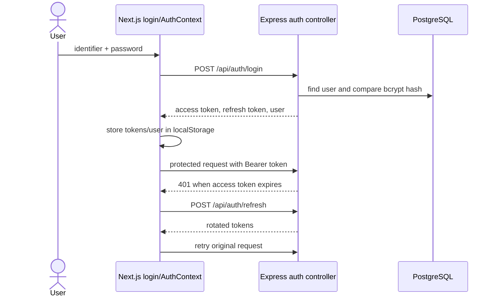
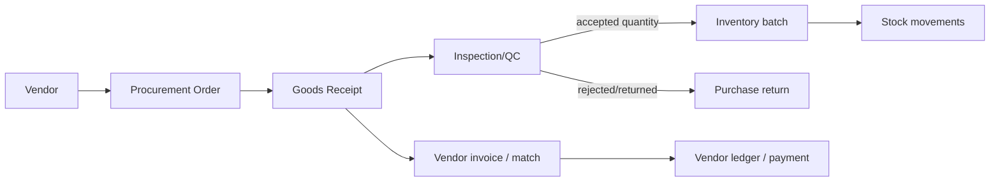
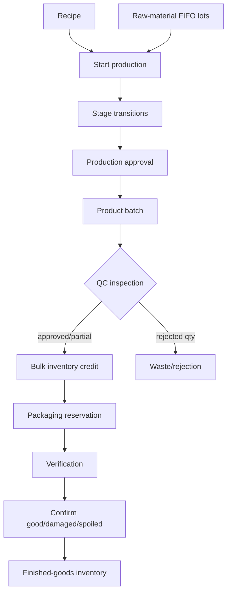
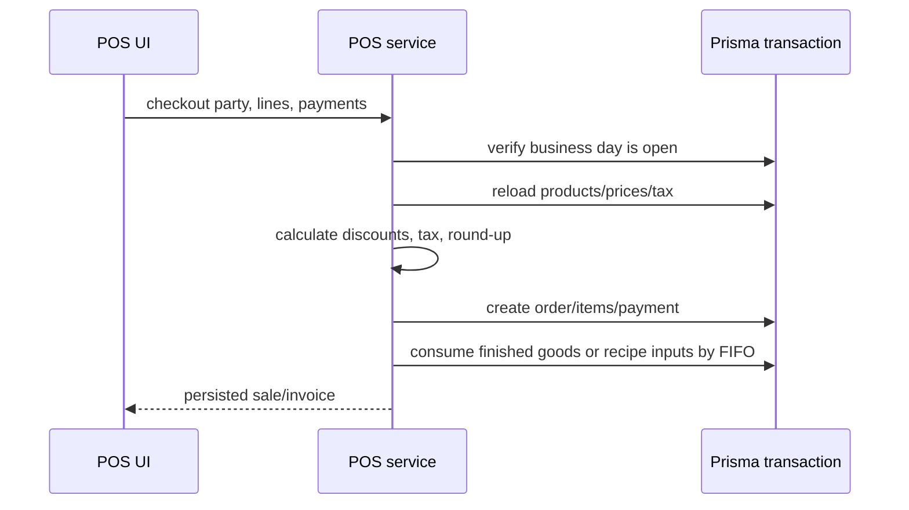

# Business Workflows

## Login and token refresh

Access tokens expire after 15 minutes and refresh tokens after 7 days in `backend/src/lib/jwt.util.ts`. Refresh tokens are persisted by the auth service in `RefreshToken` records.

## First-run setup

A logged-in super-admin loads `/api/setup/status`. `AppShell` redirects to `/setup` when initialization is incomplete. The wizard explicitly creates the HQ warehouse through `POST /api/setup/warehouse`. The health endpoint does not auto-create setup records.

## Procurement to stock

Verified rules include PO/GRN remaining-quantity checks, QC status, batch/lot tracking, vendor invoice matching and transactional stock updates. Exact approval policy per deployment is **Unknown**.

## Production and packaging

Key verified rules from `production.service.ts`:

- Ingredient availability and unit conversion are checked before consumption.
- Raw materials are consumed by FIFO; actual consumed lot cost is captured.
- Only in-progress/stopped production can be approved.
- A batch can be QC-inspected only once; approved quantity is produced minus rejected quantity.
- Effective bulk unit cost is total batch cost divided by approved quantity.
- Packaging requires QC-approved or partially approved batches and is blocked during recall.
- Pending packaging reserves bulk quantity; confirmed plus pending packaging cannot exceed approved balance.
- On confirmation, good + damaged + spoiled must equal planned packet quantity.
- Confirmed finished goods use actual FIFO bulk cost; cancellation releases reservation.

## POS sale and settlement

Server-side rules in `pos.service.ts` include: do not trust client prices/tax/totals; customer master discounts do not apply to dealer/franchise sales; manual discount cannot make the bill negative; tax is calculated per product; total is rounded upward to the next rupee; insufficient stock blocks checkout; a settled business day blocks more sales.

## Sales document chain

Quotations can convert to sales orders or sales. Sales orders can convert to sales. Proforma invoices can convert to sales orders or another downstream sales document. Delivery challans can be delivered and converted to sale. Returns have update and refund operations. Conversion endpoints are listed in [API_REFERENCE.md](API_REFERENCE.md); the exact copied-field matrix should be verified in `sales.service.ts` before changing it.

## GST calculation

`gst-tax.util.ts` resolves inter-state status. `gst-invoice.service.ts` applies IGST for inter-state transactions or splits tax into CGST/SGST for intra-state transactions, rounds line/aggregate values, and rejects invoicing cancelled franchise orders.

## E-Way Bill lifecycle

`DRAFT → GENERATED → CANCELLED/EXPIRED` behavior is enforced by `ewaybill.service.ts`. Only drafts can be edited/deleted/exported. Generated bills can receive vehicle updates; extension is limited to the eight-hour window around expiry; cancellation is limited to 24 hours after generation. GSTIN, PIN, state, HSN, quantity, UQC, tax, distance and vehicle formats are validated server-side.

## Franchise transfer

Only finished goods may be transferred to branches. Transfer dispatch consumes inventory using strict FIFO. Requests/transfers progress through create, approve, dispatch and complete endpoints; franchise/service filters restrict branch-visible data.

## Recall

The recall workflow exposes eligibility, initiate, locate distribution, block sales, report generation, collect return, complete and cancel steps. Packaging and other stock operations check recall state. Detailed transition constraints live in `production/recall.service.ts`.
