# Data Flow Diagrams

These diagrams are derived strictly from the inspected frontend and backend source. Route names are taken from `backend/src/app.ts` and mounted router files; data stores use Prisma model names from `backend/prisma/schema.prisma`. No production records were accessed.

## Notation and boundaries

- Rectangles represent people or external systems.
- Rounded nodes represent application processes.
- Cylinders represent PostgreSQL data stores, labelled with actual Prisma models.
- Socket.IO is an internal frontend/backend transport, not an independent external business system.
- GST Verify is the only verified third-party HTTP integration. A direct government NIC E-Way Bill submission integration was not verified.
- When an exact stable DTO is not declared, the diagram names the data concept rather than inventing a payload.

## Level 0 — Context Diagram

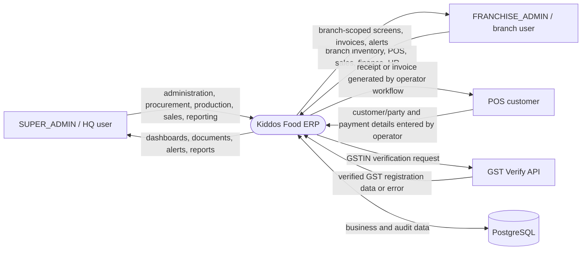

Customer interaction is indirect: the repository contains no customer self-service frontend. A cashier/operator enters the sale and produces the customer document.

## Level 1 — System Data Flow

```mermaid
flowchart TB
  U[HQ or franchise browser user]

  subgraph FE[Next.js frontend]
    P[App Router pages and module components]
    AC[AuthContext]
    AX[Axios client and API modules]
    NC[NotificationContext]
    LS[(Browser localStorage: access token, refresh token, user)]
  end

  subgraph BE[Node.js / Express backend]
    ER[Express routes in src/app.ts and mounted routers]
    AU[authenticate and authorizeRole]
    CT[Domain controllers]
    SV[Domain services and Prisma transactions]
    SI[Socket.IO service]
    EH[Central error handler]
  end

  PG[(PostgreSQL via Prisma)]
  GST[GST Verify API]

  U -->|forms, filters, commands| P
  P -->|login/session actions| AC
  AC <--> LS
  P -->|feature API calls| AX
  AX -->|HTTP JSON and Bearer JWT| ER
  ER --> AU
  AU -->|verified req.user with role/franchiseId| CT
  CT -->|validated command/query| SV
  SV <--> |Prisma reads and transactions| PG
  SV -->|result| CT
  CT -->|JSON or file response| AX
  AX -->|state/results/errors| P
  ER -->|errors| EH
  EH -->|normalized error response| AX
  SV -->|GSTIN request| GST
  GST -->|registration response| SV
  SV -->|domain events| SI
  SI -->|Socket.IO room events| NC
  NC -->|notification state| P
```

### Level 1 route groups

| Flow | Frontend/API entry | Backend processing | Primary stores |
|---|---|---|---|
| Authentication | `/login`, `/api/auth/*`, `/api/me` | AuthController/AuthService, JWT utility | User, RefreshToken |
| Setup | `/setup`, `/api/setup/*` | SetupController/SetupService | Franchise, Warehouse, NumberSequence |
| Procurement | `/purchases/*`, `/api/purchase-orders`, `/api/grn`, `/api/qc` | Procurement, GRN, inspection, vendor-invoice services | Vendor, ProcurementOrder, GoodsReceipt, InventoryBatch, VendorInvoice |
| Inventory | `/inventory/*`, `/api/inventory/*`, `/api/warehouse/*` | Inventory and warehouse services | InventoryItem, InventoryBatch, StockMovement, Warehouse/Bin, Reservation |
| Production | `/production/*`, `/packaging/*`, `/api/production/*` | Production, carton and recall services | Recipe, Production, ProductBatch, ProductPackaging, WasteEntry, BatchRecall |
| Sales/POS | `/pos`, `/sales/*`, `/api/orders`, `/api/sales/*` | POS, order, sales and finance services | Order/Item, Quotation, SalesOrder, Invoice, Payment, ReturnOrder |
| Franchise/logistics | `/franchise*`, `/api/franchise*`, `/api/logistics/*` | Franchise and logistics services | Franchise, FranchiseOrder, StockRequest, StockTransfer, FranchiseLedger |
| Finance/reporting | `/accounting/*`, `/reports/*`, `/api/reports/*` | Finance/account/cheque/GST services | Account, Payment, Expense, ledgers, LoanAccount, operational tables |
| HR/payroll | `/hr/*`, `/api/employees`, `/api/payroll/*` | Employee and payroll services | Employee, AttendanceLog, Leave, Shift, Payroll, Payslip |
| Alerts/audit | `/alerts`, `/audit/logs`, `/api/alerts`, `/api/audit/logs` | Alert/Audit services and Socket.IO | Alert, AuditLog, ActivityLog |

# Level 2 — Module Data Flows

## 2.1 Authentication, user administration and setup

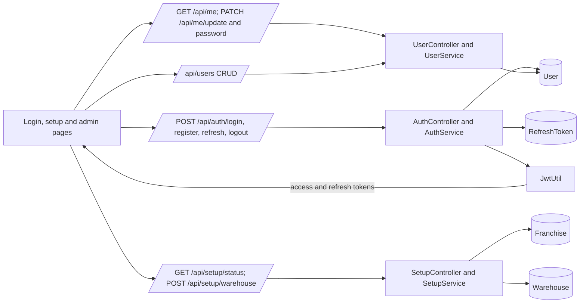

## 2.2 Vendors, procurement, GRN, QC and vendor invoices

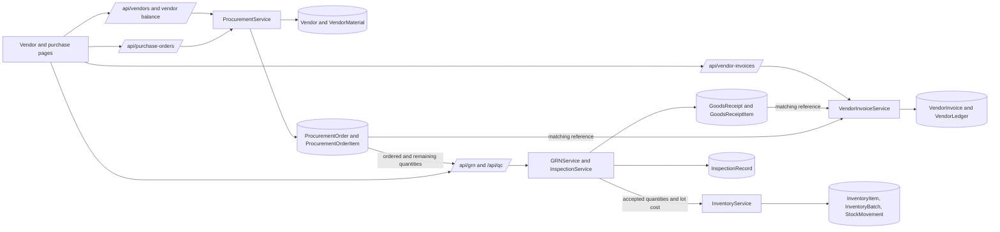

The endpoint inventory in `API_REFERENCE.md` is authoritative for individual PO, GRN, QC and invoice operations.

## 2.3 Purchase requests, RFQ and purchase returns

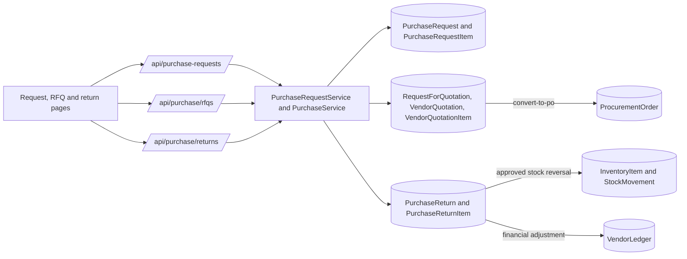

## 2.4 Product, recipe and unit master data

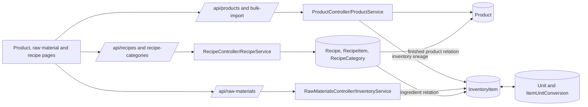

## 2.5 Inventory, batches, reservations and warehouse bins

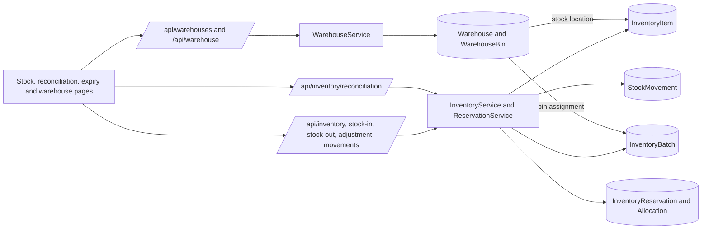

FIFO-consuming services read `InventoryBatch` and record `StockMovement`; reservations prevent pending workflows from oversubscribing stock.

## 2.6 Production, QC, packaging and cartons

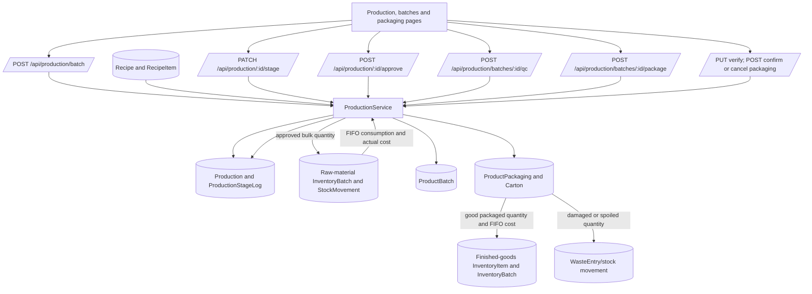

## 2.7 Waste and batch recall

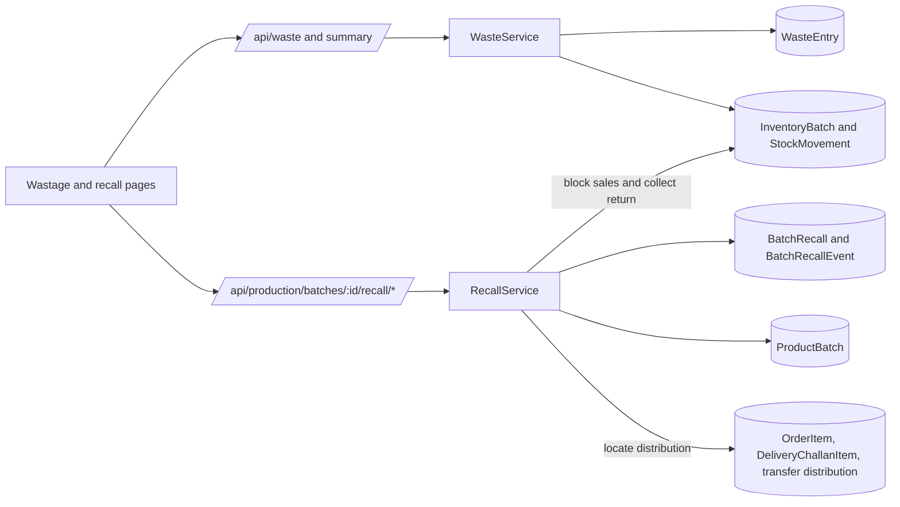

Verified recall route steps are eligibility, state, initiate, locate-distribution, block-sales, generate-report, collect-return, complete and cancel.

## 2.8 POS, payments, cheques and day settlement

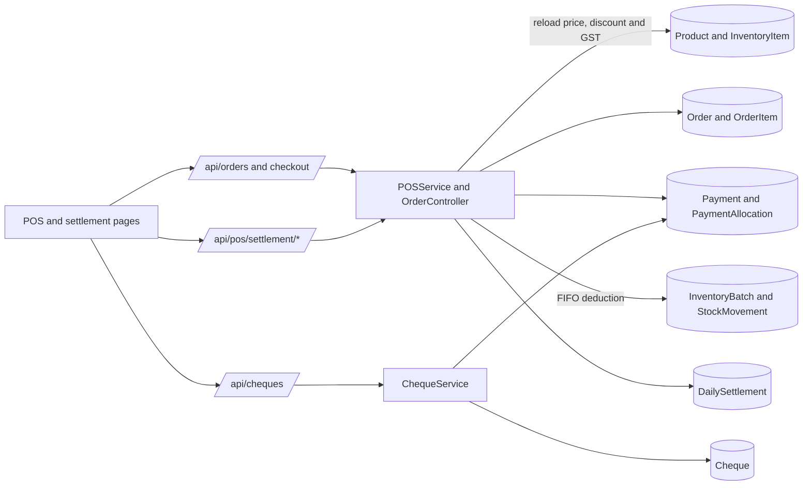

## 2.9 Sales quotations, orders, invoices, delivery challans and returns

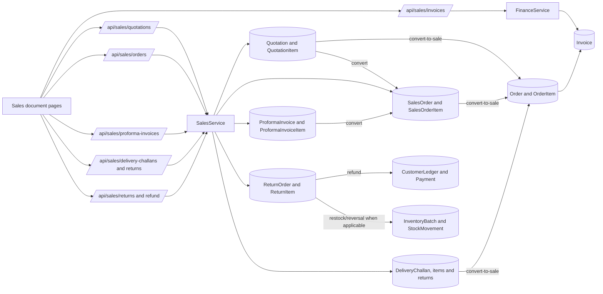

## 2.10 Customers, dealers and business partners

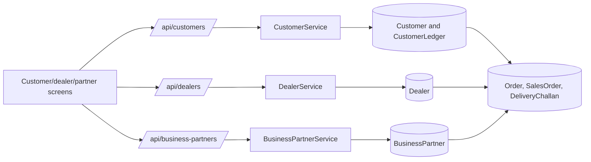

## 2.11 Franchise orders, requests and stock transfers

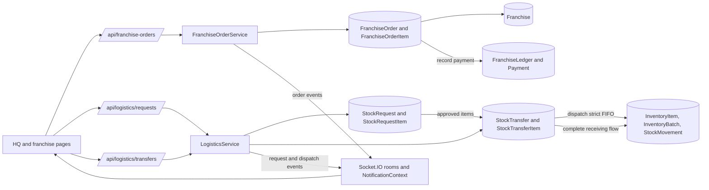

## 2.12 Accounts, expenses, ledgers, loans and reports

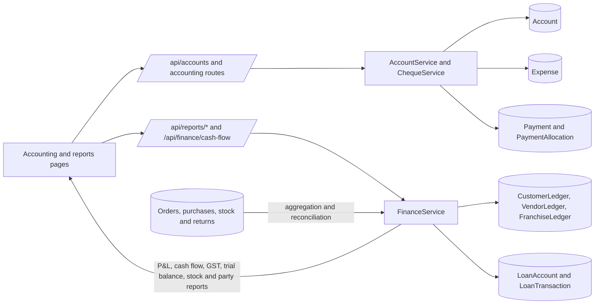

Reports are computed from operational data; a separate reporting warehouse was not found.

## 2.13 GST verification and E-Way Bills

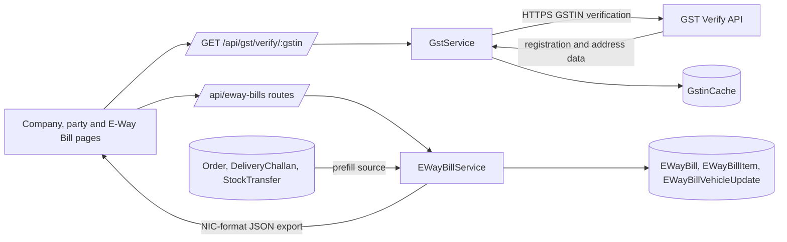

No verified direct NIC submission process is shown because none was established in source.

## 2.14 HR, attendance, leave, shifts and payroll

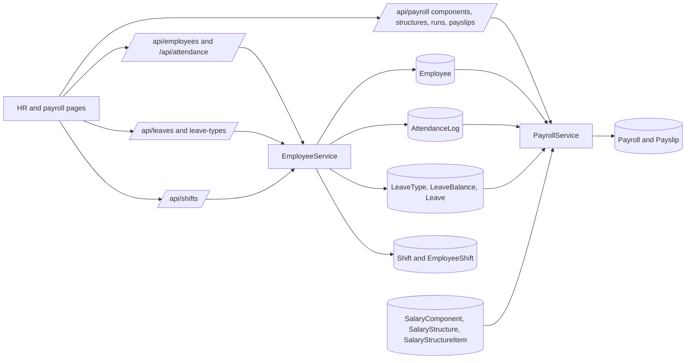

## 2.15 Alerts, audit, drafts and attachments

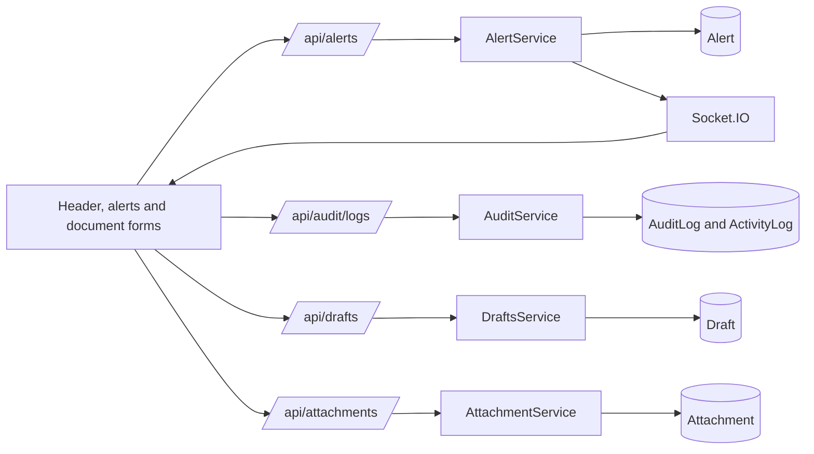

# Sequence Diagrams

## Login and refresh

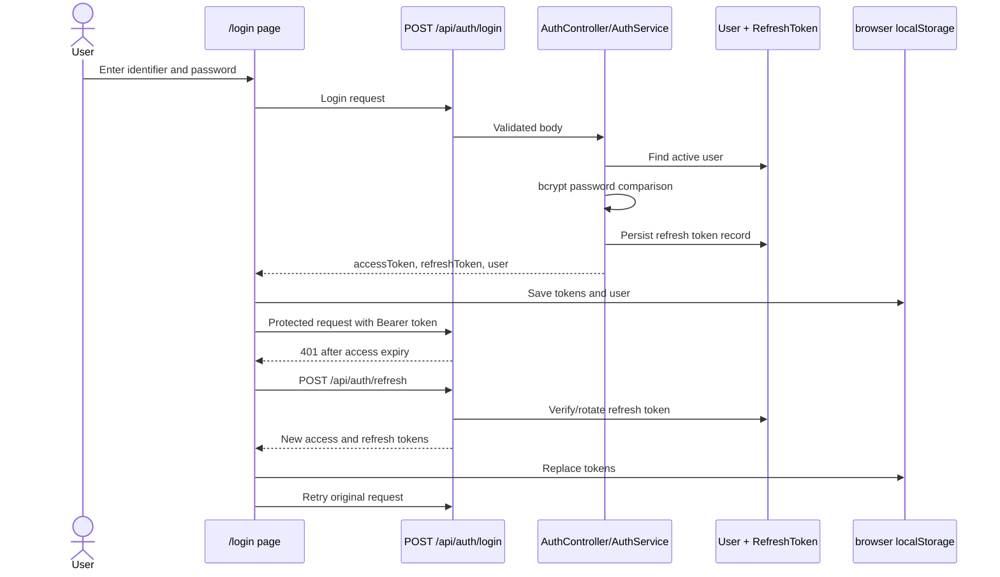

## Purchase order to GRN and inventory

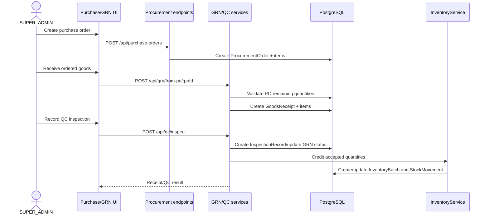

## Production through packaging

```mermaid
sequenceDiagram
  actor Admin as SUPER_ADMIN
  participant UI as Production UI
  participant PS as ProductionService
  participant DB as PostgreSQL
  participant INV as InventoryService

  Admin->>UI: Start recipe batch
  UI->>PS: POST /api/production/batch
  PS->>DB: Load Recipe + RecipeItems
  PS->>INV: Validate and consume raw material FIFO
  INV->>DB: InventoryBatch depletion + StockMovement
  PS->>DB: Create Production and cost breakdown
  Admin->>UI: Advance stages and approve
  UI->>PS: PATCH stage / POST approve
  PS->>DB: Create ProductBatch
  Admin->>UI: Submit QC result
  UI->>PS: POST /api/production/batches/:id/qc
  PS->>DB: Set approved/rejected quantity; credit bulk stock once
  Admin->>UI: Start and verify packaging
  UI->>PS: POST package / PUT verify
  PS->>DB: Reserve bulk quantity in ProductPackaging
  Admin->>UI: Confirm good, damaged, spoiled totals
  UI->>PS: POST /api/production/packagings/:id/confirm
  PS->>INV: Consume reserved bulk FIFO and credit finished goods
  INV->>DB: Stock movements and finished-goods batch
  PS-->>UI: Confirmed packaging result
```

## POS checkout and settlement

```mermaid
sequenceDiagram
  actor Cashier as Authorized ERP user
  participant UI as /pos
  participant POS as POSService
  participant DB as PostgreSQL
  participant INV as InventoryService

  Cashier->>UI: Select party, products and payment
  UI->>POS: POST /api/orders/checkout
  POS->>DB: Confirm business day is not settled
  POS->>DB: Reload product price, discount and GST
  POS->>POS: Calculate lines, tax, discount and upward round-off
  POS->>INV: Check and consume finished goods/recipe inputs FIFO
  INV->>DB: InventoryBatch + StockMovement updates
  POS->>DB: Create Order, OrderItems and Payment
  POS-->>UI: Persisted sale/invoice data
  Cashier->>UI: Close day
  UI->>POS: POST /api/pos/settlement/close
  POS->>DB: Validate totals and create DailySettlement
  POS-->>UI: Settlement result
```

## Quotation to sale and payment

```mermaid
sequenceDiagram
  actor User as HQ or franchise user
  participant UI as Sales UI
  participant Sales as SalesService
  participant Finance as FinanceService
  participant DB as PostgreSQL

  User->>UI: Create quotation
  UI->>Sales: POST /api/sales/quotations
  Sales->>DB: Create Quotation + items
  User->>UI: Convert quotation
  UI->>Sales: POST /api/sales/quotations/:id/convert-to-sales-order
  Sales->>DB: Create SalesOrder + items
  User->>UI: Convert sales order to sale
  UI->>Sales: POST /api/sales/orders/:id/convert-to-sale
  Sales->>DB: Create Order/Invoice references
  User->>UI: Record payment
  UI->>Finance: POST /api/accounting/payments
  Finance->>DB: Create Payment, allocation and ledger effects
  Finance-->>UI: Updated payment/receivable result
```

## Franchise stock request and transfer

```mermaid
sequenceDiagram
  actor Branch as FRANCHISE_ADMIN
  actor HQ as SUPER_ADMIN
  participant API as LogisticsService
  participant DB as PostgreSQL
  participant INV as InventoryService
  participant RT as Socket.IO

  Branch->>API: POST /api/logistics/requests
  API->>DB: Create StockRequest + items
  API->>RT: Emit request event
  RT-->>HQ: Realtime notification
  HQ->>API: PATCH /api/logistics/requests/:id/approve
  API->>DB: Update approval and approved quantities
  HQ->>API: POST /api/logistics/transfers
  API->>DB: Create StockTransfer + items
  HQ->>API: PATCH /api/logistics/transfers/:id/dispatch
  API->>INV: Strict FIFO finished-goods deduction
  INV->>DB: StockMovement and source stock update
  API->>RT: Emit dispatch event
  RT-->>Branch: Realtime notification
  Branch->>API: PATCH /api/logistics/transfers/:id/complete
  API->>DB: Complete transfer and receiving stock effects
```

## Sales return and refund

```mermaid
sequenceDiagram
  actor User
  participant UI as Sales returns page
  participant Sales as SalesService
  participant DB as PostgreSQL
  participant INV as InventoryService
  participant FIN as Finance/ledger processing

  User->>UI: Create return against sale
  UI->>Sales: POST /api/sales/returns
  Sales->>DB: Validate source sale and create ReturnOrder + items
  User->>UI: Approve/update return
  UI->>Sales: PATCH /api/sales/returns/:id
  Sales->>INV: Apply eligible stock return by condition/workflow
  INV->>DB: InventoryBatch/StockMovement update
  User->>UI: Issue refund
  UI->>Sales: POST /api/sales/returns/:id/refund
  Sales->>FIN: Validate and post refund
  FIN->>DB: Payment/ledger effects
  Sales-->>UI: Updated return/refund result
```

## E-Way Bill draft to generation and cancellation

```mermaid
sequenceDiagram
  actor User
  participant UI as E-Way Bill UI
  participant EWB as EWayBillService
  participant DB as EWayBill tables
  participant SRC as Sale/DC/Transfer tables

  User->>UI: Select source document
  UI->>EWB: GET /api/eway-bills/prefill
  EWB->>SRC: Read source and party/item data
  EWB-->>UI: Prefill result
  User->>UI: Save draft
  UI->>EWB: POST /api/eway-bills
  EWB->>EWB: Validate GSTIN, PIN, HSN, UQC, tax and transport
  EWB->>DB: Create EWayBill + items as DRAFT
  User->>UI: Generate/record number
  UI->>EWB: POST /api/eway-bills/:id/generate
  EWB->>DB: Enforce uniqueness/time rules; set GENERATED
  opt Vehicle update
    UI->>EWB: POST /api/eway-bills/:id/vehicle
    EWB->>DB: Create vehicle update record
  end
  opt Cancellation within verified window
    UI->>EWB: POST /api/eway-bills/:id/cancel
    EWB->>DB: Set cancellation state and reason
  end
```

## Evidence references

- Frontend shell and API transport: `src/components/layout/AppShell.tsx`, `src/context/AuthContext.tsx`, `src/context/NotificationContext.tsx`, `src/lib/api/base.ts`.
- Route declarations: `backend/src/app.ts`, dedicated `*.routes.ts` files and module `index.ts` routers.
- Business logic: module services under `backend/src/modules`.
- Database models: `backend/prisma/schema.prisma`.
- Complete endpoint and schema inventories: [API_REFERENCE.md](API_REFERENCE.md) and [DATABASE_SCHEMA.md](DATABASE_SCHEMA.md).
- Detailed verified business rules: [BUSINESS_WORKFLOWS.md](BUSINESS_WORKFLOWS.md).
