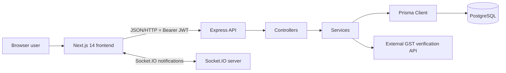

# Project Overview

## Purpose

Kiddos Food ERP is a multi-module food-business ERP. The code supports HQ (`SUPER_ADMIN`) and branch/franchise (`FRANCHISE_ADMIN`) operation across procurement, raw-material and finished-goods inventory, recipes, production/QC/packaging, POS, sales documents, dispatch, franchise stock, finance, GST reports, HR/payroll, alerts, audit and first-run setup.

## Architecture

This is a two-repository application, not a monorepo. The frontend and backend have separate `package.json`, lockfiles and Git histories.

## Frontend stack

- Next.js `14.2.15`, React `18.2`, TypeScript.
- App Router under `src/app`; root entry is `src/app/layout.tsx`.
- Tailwind CSS with CSS-variable light/dark tokens in `src/app/globals.css`.
- Axios API layer under `src/lib/api`; Socket.IO client in `src/context/NotificationContext.tsx`.
- React Context providers for authentication, notifications, theme, sidebar, toast and purchase-order editing.
- Recharts, Framer Motion, Lucide icons, `xlsx`, jsPDF/html2canvas and QR/barcode helpers.
- Vitest + Testing Library for the small frontend test suite.

## Backend stack

- Node.js, Express `4.18`, TypeScript, `tsx` in development.
- Prisma `7.8` with PostgreSQL (`prisma/schema.prisma`).
- JWT access/refresh tokens, bcrypt password hashing, Zod validation.
- Socket.IO initialized through `src/lib/socket.ts` from `src/index.ts`.
- Source entry: `backend/src/index.ts`; Express composition: `backend/src/app.ts`.
- Compiled entry: `backend/dist/index.js`.

## Runtime entry points

1. Frontend `src/app/layout.tsx` installs `ThemeProvider`, `AuthProvider`, `ToastProvider`, `NotificationProvider`, `AppShell` and `react-hot-toast`.
2. `AppShell` protects non-public routes, performs first-run setup redirects and renders `Sidebar` + `RefrensHeader`.
3. Frontend API calls use the Axios instance in `src/lib/api/base.ts`.
4. Backend `src/index.ts` loads environment configuration, creates an HTTP server, initializes Socket.IO and listens on `PORT` (default `5000`).
5. Backend `src/app.ts` registers JSON parsing, request logging, routes and centralized error handling.
6. Controllers translate HTTP inputs to service calls; services use the singleton Prisma client in `src/lib/prisma.ts`.

## Roles and tenancy

The Prisma `UserRole` enum contains `SUPER_ADMIN` and `FRANCHISE_ADMIN`. JWT payloads may include `franchiseId` and `branchId`. Many services add franchise filters for non-super-admin users. Route-level RBAC is documented in [API_REFERENCE.md](API_REFERENCE.md). The exact organization/legal tenancy model is **Unknown** beyond these code constructs.

## Important dependencies

Both repositories depend on local package `@businessgroupikasle/erp-units` through `file:erp-units.tgz`. It supplies shared unit behavior; package source is not present as an unpacked workspace, so its internals are **Unknown**.
